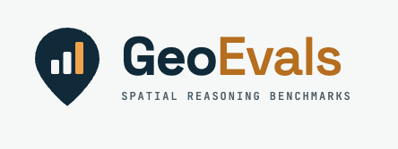

<p align="center">
  
</p>

# GeoEvals

A reproducible, practitioner-focused framework for evaluating geospatial AI systems.

## What GeoEvals evaluates, and why

General AI benchmarks score text or labels. A geospatial answer can read well and still be
wrong in a way that only a GIS check finds: the wrong axis order, a distance in degrees, a
buffer on unprojected data, a polygon that is not valid, or a join across two coordinate
reference systems (CRSs). A good score on a test region can also hide a failure in a
different region, at a different time or at a different scale.

GeoEvals helps a practitioner answer three questions:

1. **Can the system do the geospatial task?** For example GIS operations, spatial reasoning
   and network access.
2. **Can we trust its results?** Positional accuracy, correctness within stated tolerances,
   uncertainty and failure modes.
3. **Does it work in production?** Latency, throughput, failure rate, retries, memory, token
   and API cost, and reproducibility across environments.

GeoEvals is a framework, not a collection of datasets. Its core is an evaluation contract:

| Part | What it does |
| --- | --- |
| Benchmark spec | Defines the task, inputs, outputs, splits, metrics, tolerances and provenance (YAML, validated against `schemas/benchmark.schema.json`). |
| Dataset manifest | Lists every data asset with its source, license, checksum, CRS, extent and time range. |
| Adapter | Calls a model, a classical method or an agent. |
| Metrics | Score outputs independently of the adapter, with explicit units and tolerances. |
| Runner | Runs every case, isolates failures, enforces timeouts and records timing and cost. |
| Run result | A machine-readable record of everything needed to reproduce and compare a run. |
| Report | A Markdown and HTML report with per-case failures, breakdowns and limitations. |

The design rules are in [`docs/principles.md`](docs/principles.md).

## Three pillars

| Pillar | Question | Status |
| --- | --- | --- |
| Geospatial perception | Can a model extract features from imagery and other rasters (detection, segmentation, change detection)? | Not planned. Many existing benchmarks cover imagery extraction. |
| Spatial reasoning and GIS agents | Does the system do GIS operations correctly, and does it decline requests that it cannot answer? | `gis_correctness` (56 cases) |
| Human-centered place context | Can the system compute how people reach everyday places, for example walking access to amenities? | `human_context_access` (51 cases), plus a manual real-geography pilot |

## Quickstart

You need [uv](https://docs.astral.sh/uv/) and a clone of this repository. No credentials or
paid services are needed. From the repository root:

```quickstart
uv sync
uv run geoevals run --benchmark benchmarks/gis_correctness/benchmark.yaml \
  --adapter gis_baseline --config baselines/gis_correctness/gis_baseline/config.yaml \
  --out runs/quickstart --open
```

The second command runs the deterministic `gis_baseline` adapter on all 56 cases of the GIS
correctness benchmark. It writes the run to `runs/quickstart/<run_id>/` (`result.json`,
`cases.jsonl`, `config.yaml`, `run.log`, `artifacts/`), writes `report.md` and `report.html`
there, and opens `report.html` in your web browser. Without a browser, open the printed
`report.html` path yourself.

CI runs this block word for word (`tests/test_docs.py`).

Other useful commands:

```sh
uv run geoevals --help
uv run geoevals reproduce baselines/gis_correctness/gis_baseline   # rerun the published baseline
uv run geoevals compare <run_a> <run_b>                             # per-case differences
uv run geoevals validate <benchmark.yaml | manifest.yaml | result.json>
```

## Available benchmarks

| Benchmark | Pillar | Cases | Data | Card |
| --- | --- | --- | --- | --- |
| `gis_correctness` 0.2.0 | Spatial reasoning | 56: CRS transformation, distance, buffer, validity, spatial join, overlay, abstention | 13 synthetic GeoJSON fixtures (MIT) | [`benchmarks/gis_correctness/README.md`](benchmarks/gis_correctness/README.md) |
| `human_context_access` 0.2.0 | Human context | 51: travel time, amenity counts, detour ratio, opening hours, abstention | A seeded synthetic town (MIT); the real-geography pilot uses OpenStreetMap (ODbL-1.0, never committed) | [`benchmarks/human_context/README.md`](benchmarks/human_context/README.md) |
| `smoke` 0.1.0 | (CI only) | 5 | Synthetic | [`benchmarks/smoke/benchmark.yaml`](benchmarks/smoke/benchmark.yaml) |

Each card states the purpose, the operations and case counts, the tolerances, the data
provenance, the limitations and how to reproduce the results. The metrics are defined in
[`docs/metrics.md`](docs/metrics.md), and the human-context concepts in
[`docs/human-context.md`](docs/human-context.md).

v0.1 ships three adapters, and none of them needs credentials or network access:

| Adapter | What it is |
| --- | --- |
| `gis_baseline` | Deterministic Shapely, pyproj and GeoPandas answers for `gis_correctness` |
| `access_baseline` | Deterministic `scipy.sparse.csgraph` and GeoPandas answers for `human_context_access` |
| `mock` | Configurable failures (wrong output, exceptions, sleeps, retries, token counts) and scripted agent trajectories (`mode: mock_agent`) |

Not yet released: six Claude adapters for the leaderboard (`claude_direct_<model>` and
`claude_python_<model>`) run Claude models through the local Claude Code CLI. They need a
signed-in Claude Code and, for the python track, Docker. See
[`leaderboard/README.md`](leaderboard/README.md).

## Leaderboard

Claude models on the two v0.1.0 benchmarks, in two tracks: **direct**, where the model answers
from the input data inlined in the prompt with no tools, and **python**, where the model can run
Python (GeoPandas, Shapely, pyproj, NetworkX, SciPy) in a Docker container with no network. Every
row is a complete run on the maintainer's machine, generated from the committed results in
[`leaderboard/results/`](leaderboard/results/); these are local runs, not verified submissions.
How to run and add a model: [`leaderboard/README.md`](leaderboard/README.md).

<!-- leaderboard:start -->
No runs have been added yet. See [`leaderboard/README.md`](leaderboard/README.md).
<!-- leaderboard:end -->

## Add a benchmark, metric, adapter or dataset manifest

[`docs/benchmark-authoring.md`](docs/benchmark-authoring.md) is the guide. It has the
definition of done for a benchmark and a worked example that adds a new operation to
`gis_correctness` from start to end. In short:

- **Benchmark:** a directory under `benchmarks/` with `benchmark.yaml`, case files,
  `manifest.yaml`, a reference workflow `reference.py` and a benchmark card `README.md`.
  `uv run geoevals validate <benchmark.yaml>` checks the spec.
- **Metric:** a subclass of `geoevals.metrics.Metric` with an `id`, a semver `version`,
  `units` and `higher_is_better`, registered in `src/geoevals/metrics/__init__.py` and
  defined in `docs/metrics.md`.
- **Adapter:** a module-level class that implements the `geoevals.adapters.Adapter`
  protocol (`name`, `version`, `setup`, `predict`, `teardown`), registered in
  `src/geoevals/adapters/__init__.py`.
- **Dataset manifest:** a YAML or JSONL file that matches
  `schemas/dataset-manifest.schema.json`. `uv run geoevals data verify <manifest>` checks the
  SHA-256 of each asset. See [`docs/data-governance.md`](docs/data-governance.md).

## Versioning and comparability

Benchmarks, metrics, adapters and the three JSON Schemas each have a semantic version. Every
run result records the benchmark version, the version of every metric, the adapter version,
the split, the SHA-256 of the dataset manifest, the hash of the run config and an environment
fingerprint (Python, OS, CPU, RAM, GEOS and PROJ versions, git commit, `uv.lock` hash).

Every report states:

> Comparisons are valid only between runs with the same benchmark version, metric versions,
> split, and dataset manifest hash.

Two runs with the same config, data and lockfile give identical per-case statuses, outputs
and metrics; only timing, memory and timestamp fields differ. `geoevals compare` and
`geoevals reproduce` check this. [`docs/reproducibility.md`](docs/reproducibility.md) has the
version rules, the schema migration notes and the cross-platform tolerances.

## Data governance

- Code, schemas and benchmark specs are MIT-licensed. Each dataset keeps its own license, and
  its manifest records it.
- Only small, synthetic, redistributable fixtures are committed. Restricted data, such as
  OpenStreetMap extracts, is referenced by a manifest and downloaded into the gitignored
  `data/raw/` with `geoevals data fetch`.
- Validation fails if an asset with `redistributable: false` is tracked in git.
- Never commit credentials, precise personal location traces or sensitive operational data.
- The human-context pillar tags every value `observed`, `proxy` or `judgment`, and makes no
  claims about social relationships inferred from co-location, mobility proxies or
  demographics.

See [`docs/data-governance.md`](docs/data-governance.md).

## Documentation

| Document | Contents |
| --- | --- |
| [`docs/principles.md`](docs/principles.md) | What GeoEvals measures and the rules it follows |
| [`docs/best-practices.md`](docs/best-practices.md) | Practices for benchmark authors and evaluators |
| [`docs/metrics.md`](docs/metrics.md) | Every metric: formula, units, tolerances, edge cases, aggregation |
| [`docs/data-governance.md`](docs/data-governance.md) | Licenses, manifests, restricted data, privacy |
| [`docs/benchmark-authoring.md`](docs/benchmark-authoring.md) | How to add a benchmark, case, metric, adapter or manifest; definition of done |
| [`docs/reproducibility.md`](docs/reproducibility.md) | Versions, comparability, run determinism, reproduction |
| [`docs/human-context.md`](docs/human-context.md) | Human-context concepts and evidence types |
| [`docs/release-checklist.md`](docs/release-checklist.md) | The release acceptance checklist: what CI verifies and what needs human sign-off |

## Contributing

[`CONTRIBUTING.md`](CONTRIBUTING.md) covers the development setup, the quality gates, the
benchmark definition of done and the version rules. Everyone who takes part follows the
[code of conduct](CODE_OF_CONDUCT.md). In short, set up the environment and run the quality
gates before you open a pull request:

```sh
uv sync
uv run ruff check . && uv run ruff format --check . && uv run pyright && uv run pytest
```

CI runs the same gates on Ubuntu (Python 3.11 and 3.12) and macOS (Python 3.12). It also
validates every benchmark spec and manifest, runs the smoke benchmark and this README's
quickstart, and reproduces the published baseline. A new benchmark must meet the definition of
done in [`docs/benchmark-authoring.md`](docs/benchmark-authoring.md#definition-of-done).

**Security:** report vulnerabilities privately through GitHub Security Advisories ("Report a
vulnerability" on the repository's Security tab), not in a public issue. See
[`SECURITY.md`](SECURITY.md).

## Citation

[`CITATION.cff`](CITATION.cff) has the citation metadata (GitHub shows it as "Cite this
repository"). In text:

> GeoEvals contributors (2026). *GeoEvals: a reproducible framework for evaluating geospatial
> AI systems*, version 0.1.0. MIT License.

When you report results, also cite the benchmark ID and version, the metric versions and the
dataset manifest hash, and cite each dataset as its manifest asks (`citation`, `attribution`).

## Roadmap

v0.1 covers the contracts, the GIS correctness benchmark and the human-context pilot. After
v0.1:

- a vector benchmark with OpenStreetMap data as the input
- LLM and hosted-API adapters (the adapter protocol already records tokens and cost)
- agentic GIS tasks with real agents, executable reference trajectories and output validation
- more place-context cases, and temporal and geographic transfer evaluations
- a leaderboard, only after comparability and verification rules are defined

[`ROADMAP.md`](ROADMAP.md) describes each item, and [`CHANGELOG.md`](CHANGELOG.md) lists what
each release contains.

## Maintainers

TODO(maintainer): list the maintainers and the hosting organization (open question 3 in the
v0.1 plan).

## License

MIT, copyright GeoEvals contributors. See [`LICENSE`](LICENSE). Datasets keep their own
licenses; see each benchmark's `manifest.yaml`.
