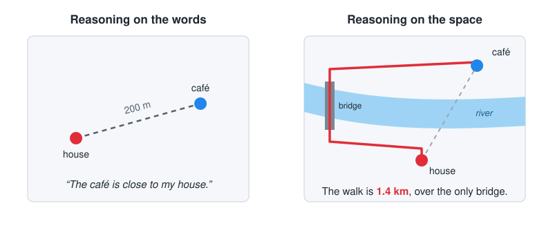
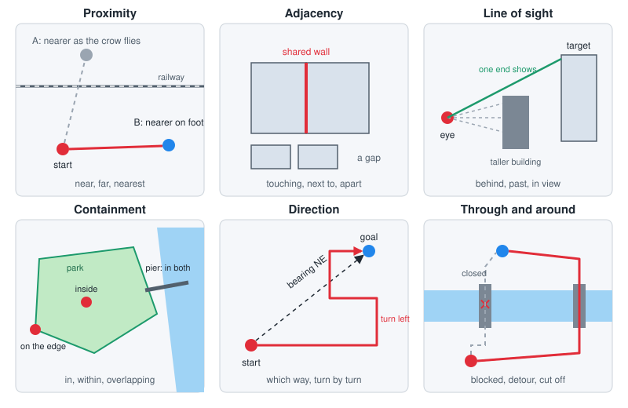

<p align="center">
  
</p>

# GeoEvals

A reproducible, practitioner-focused framework for evaluating GeoAI systems.

## Why spatial reasoning needs its own tests

GeoAI can be more than interpreting pixels in imagery and words used to describe places, but needs a way to measure how well it can capture the concepts of geospatial relationships.  Language models learn about places from the words people use to describe them: "near the
river", "behind the courthouse", "just across the bridge". But the words are not the space. A
café can be "close" to a house 200 meters away and still be a 1.4-kilometer walk, because a
river runs between them and the only bridge is upstream. A model that reasons only on the
language will miss that, and it will miss it confidently. GeoEvals is built on the view that AI
systems should reason directly on spatial relationships, the geometry, networks and heights
themselves, and not only on the language we use for them. That capability belongs in
multimodal frontier models, and it needs a way to be measured.  GeoEvals provides both deteministic benchmarks as well as agent scored evals. It's important to collect stats on the time and cost of reaching a solution as well. Complex reasoning often requires a model to revisit the question several times before submitting an answer.

<p align="center">
  
</p>

GeoEvals offers researchers and practitioners in GeoAI a suite of benchmarks and evals to
gauge how well models, and the harnesses and tools around them, handle spatial thinking, and
to track that as they improve. The evals ask open questions about a real town, and each answer
is checked against facts computed from the map data:

<p align="center">
  
</p>

- **Proximity:** what is near, far or nearest, measured on foot rather than as the crow flies.
- **Adjacency:** what touches, shares a wall or is next to what, and what a closure cuts off.
- **Line of sight:** what can be seen from a spot, and what is hidden behind a taller building.
- **Containment:** what lies inside, on the edge of, or across an area.
- **Direction:** which way to go, the bearing compared with the turns of the actual walk, and
  the routes around or through a barrier.
- **Others to come:** see [Future work](#future-work).

It's likely that we will get improvements in autonomous driving, package deliveries, robotics, and applications in urban planning and management from AI systems that absorb these concepts into their models directly.


## What GeoEvals evaluates, and why

General AI benchmarks score text or labels. A geospatial answer can read well and still be
wrong: the wrong axis order, a distance in units of degrees, a
buffer on unprojected data, a polygon that is not valid, or a join across two coordinate
reference systems (CRSs). A good score on a test region can also hide a failure in a
different region, at a different time or at a different scale. The scoring of a particular model is given against each task category and for the model alone, and the model with soem Python tools available that can work with geospatial data. 

GeoEvals helps a practitioner answer three questions:

1. **Can the system do the geospatial task?** For example GIS operations, spatial reasoning
   and network access.
2. **Can we trust its results?** Positional accuracy, correctness within stated tolerances,
   uncertainty and failure modes.
3. **Does it work in production?** Latency, throughput, failure rate, retries, memory, token
   and API cost, and reproducibility across environments.

GeoEvals is a framework, not a collection of datasets. Its core is an evaluation contract:

| Part | What it does |
| --- | --- |
| Benchmark spec | Defines the task, inputs, outputs, splits, metrics, tolerances and provenance (YAML, validated against `schemas/benchmark.schema.json`). |
| Dataset manifest | Lists every data asset with its source, license, checksum, CRS, extent and time range. |
| Adapter | Calls a model, a classical method or an agent. |
| Metrics | Score outputs independently of the adapter, with explicit units and tolerances. |
| Runner | Runs every case, isolates failures, enforces timeouts and records timing and cost. |
| Run result | A machine-readable record of everything needed to reproduce and compare a run. |
| Report | A Markdown and HTML report with per-case failures, breakdowns and limitations. |

The design rules are in [`docs/principles.md`](docs/principles.md).

## Three pillars

| Pillar | Question | Status |
| --- | --- | --- |
| Geospatial perception | Can a model extract features from imagery and other rasters (detection, segmentation, change detection)? | Not planned. Many existing benchmarks cover imagery extraction. |
| Spatial reasoning and GIS agents | Does the system do GIS operations correctly, and does it decline requests that it cannot answer? | `gis_correctness` (56 cases) |
| Human-centered place context | Can the system compute how people reach everyday places, for example walking access to amenities? | `human_context_access` (51 cases), plus a manual real-geography pilot |

## Quickstart

You need [uv](https://docs.astral.sh/uv/) and a clone of this repository. No credentials or
paid services are needed. From the repository root:

```quickstart
uv sync
uv run geoevals run --benchmark benchmarks/gis_correctness/benchmark.yaml \
  --adapter gis_baseline --config baselines/gis_correctness/gis_baseline/config.yaml \
  --out runs/quickstart --open
```

The second command runs the deterministic `gis_baseline` adapter on all 56 cases of the GIS
correctness benchmark. It writes the run to `runs/quickstart/<run_id>/` (`result.json`,
`cases.jsonl`, `config.yaml`, `run.log`, `artifacts/`), writes `report.md` and `report.html`
there, and opens `report.html` in your web browser. Without a browser, open the printed
`report.html` path yourself.

CI runs this block word for word (`tests/test_docs.py`).

Other useful commands:

```sh
uv run geoevals --help
uv run geoevals reproduce baselines/gis_correctness/gis_baseline   # rerun the published baseline
uv run geoevals compare <run_a> <run_b>                             # per-case differences
uv run geoevals validate <benchmark.yaml | manifest.yaml | result.json>
```

## Benchmarks (deterministic)

Each benchmark task has one checkable answer, scored by code against an expected output and stated tolerances. Open-ended tasks are graded evals instead (see [Graded evals](#graded-evals-agent-graded)).

| Benchmark | Pillar | Cases | Data | Card |
| --- | --- | --- | --- | --- |
| `gis_correctness` 0.3.0 | Spatial reasoning | 56: CRS transformation, distance, buffer, validity, spatial join, overlay, abstention | 13 synthetic GeoJSON fixtures (MIT) | [`benchmarks/gis_correctness/README.md`](benchmarks/gis_correctness/README.md) |
| `human_context_access` 0.2.0 | Human context | 51: travel time, amenity counts, detour ratio, opening hours, abstention | A seeded synthetic town (MIT); the real-geography pilot uses OpenStreetMap (ODbL-1.0, never committed) | [`benchmarks/human_context/README.md`](benchmarks/human_context/README.md) |
| `smoke` 0.1.0 | (CI only) | 5 | Synthetic | [`benchmarks/smoke/benchmark.yaml`](benchmarks/smoke/benchmark.yaml) |

Each card states the purpose, the operations and case counts, the tolerances, the data
provenance, the limitations and how to reproduce the results. The metrics are defined in
[`docs/metrics.md`](docs/metrics.md), and the human-context concepts in
[`docs/human-context.md`](docs/human-context.md).

v0.1 ships three adapters, and none of them needs credentials or network access:

| Adapter | What it is |
| --- | --- |
| `gis_baseline` | Deterministic Shapely, pyproj and GeoPandas answers for `gis_correctness` |
| `access_baseline` | Deterministic `scipy.sparse.csgraph` and GeoPandas answers for `human_context_access` |
| `mock` | Configurable failures (wrong output, exceptions, sleeps, retries, token counts) and scripted agent trajectories (`mode: mock_agent`) |

Not yet released: six Claude adapters for the leaderboard (`claude_direct_<model>` and
`claude_python_<model>`) run Claude models through the local Claude Code CLI. They need a
signed-in Claude Code and, for the python track, Docker. See
[`leaderboard/README.md`](leaderboard/README.md).

## Leaderboard

Claude models on the two v0.1.0 benchmarks, in two tracks: **direct**, where the model answers
from the input data inlined in the prompt with no tools, and **python**, where the model can run
Python (GeoPandas, Shapely, pyproj, NetworkX, SciPy) in a Docker container with no network. Every
row is a complete run on the maintainer's machine, generated from the committed results in
[`leaderboard/results/`](leaderboard/results/); these are local runs, not verified submissions.
How to run and add a model: [`leaderboard/README.md`](leaderboard/README.md).

<!-- leaderboard:start -->
| Model | Track | Benchmark | Task success (95% CI) | Not scored | Latency p50 / p90 (s) | Tokens in | Tokens out |
| --- | --- | --- | --- | ---: | ---: | ---: | ---: |
| Opus 5.5 | direct | `gis_correctness` 0.3.0 | 0.804 [0.70, 0.91] | 0 of 56 | 9.2 / 108.8 | 148,766 | 244,931 |
| Sonnet 5.5 | direct | `gis_correctness` 0.3.0 | 0.691 [0.56, 0.80] | 1 of 56 | 6.6 / 90.4 | 146,410 | 210,830 |
| Haiku 5.5 | direct | `gis_correctness` 0.3.0 | 0.800 [0.69, 0.91] | 1 of 56 | 8.9 / 325.5 | 149,465 | 1,100,530 |
| Opus 5.5 | python | `gis_correctness` 0.3.0 | 0.964 [0.91, 1.00] | 0 of 56 | 7.0 / 13.5 | 383,637 | 34,037 |
| Sonnet 5.5 | python | `gis_correctness` 0.3.0 | 0.929 [0.86, 0.98] | 0 of 56 | 6.9 / 12.3 | 412,122 | 32,511 |
| Haiku 5.5 | python | `gis_correctness` 0.3.0 | 0.911 [0.84, 0.98] | 0 of 56 | 7.6 / 15.2 | 499,170 | 60,401 |
| Opus 5.5 | direct | `human_context_access` 0.2.0 | 0.961 [0.90, 1.00] | 0 of 51 | 13.9 / 24.1 | 3,244,870 | 71,071 |
| Sonnet 5.5 | direct | `human_context_access` 0.2.0 | 0.725 [0.61, 0.84] | 0 of 51 | 15.0 / 24.8 | 3,245,074 | 89,898 |
| Haiku 5.5 | direct | `human_context_access` 0.2.0 | 0.882 [0.78, 0.96] | 0 of 51 | 38.3 / 75.5 | 3,244,964 | 469,903 |
| Opus 5.5 | python | `human_context_access` 0.2.0 | 0.980 [0.94, 1.00] | 0 of 51 | 19.0 / 25.8 | 896,689 | 77,564 |
| Sonnet 5.5 | python | `human_context_access` 0.2.0 | 0.882 [0.78, 0.96] | 0 of 51 | 17.0 / 21.7 | 839,798 | 79,134 |
| Haiku 5.5 | python | `human_context_access` 0.2.0 | 0.745 [0.63, 0.86] | 0 of 51 | 28.4 / 39.2 | 1,808,326 | 232,847 |

Run locally through Claude Code 2.1.296 on a Claude subscription, effort high, prompt version v1. Benchmarks: `gis_correctness` 0.3.0, manifest `20beb1d10b21`; `human_context_access` 0.2.0, manifest `f2d344c9051b`.

Task success is the mean of `task_success` over every case, with its 95% interval; cases that were not scored (errors, invalid output, timeouts) count as failures. Latency is the wall-clock time per case, including CLI startup. Tokens in count every prompt token the model processed, cache reads included; tokens out include thinking. Runs on a subscription have no per-token charge, so there is no cost column.
<!-- leaderboard:end -->

## Graded evals (agent-graded)

Open-ended spatial-reasoning tasks on a real city (proximity, adjacency, visibility,
containment, direction), answered by Claude models on the python track with the whole city
mounted, and scored by Claude Opus 5.5 against a rubric and a reference key computed from the
data. Each answer is graded twice. The table shows each model's distribution of task scores
(0 to 1); the box plots show the same numbers. Graded scores measure something different from
benchmark scores and are never combined with them. How evals are written and graded:
[`docs/eval-authoring.md`](docs/eval-authoring.md).

Five evals on Oregon City, Oregon, each 12 tasks in three tiers (describe, analyze, infer), are
frozen: visibility at 0.2.0, the other four at 0.1.0. Results will appear below once runs are made.

| Eval | Concept |
| --- | --- |
| [`proximity`](evals/proximity/eval.yaml) | Nearness on foot against nearness on the map, across rivers and rail |
| [`adjacency`](evals/adjacency/eval.yaml) | Shared walls against corner touches; what a closure does to a walk |
| [`visibility`](evals/visibility/eval.yaml) | Lines of sight between buildings with heights; undecided views |
| [`containment`](evals/containment/eval.yaml) | Inside, on the edge of or across an area: boundaries, parks, land use, water, buildings |
| [`direction`](evals/direction/eval.yaml) | Turn-by-turn directions with landmarks; misleading bearings |

<!-- graded:start -->
No graded runs have been added yet. See [`evals/README.md`](evals/README.md).
<!-- graded:end -->

## Add a benchmark, metric, adapter or dataset manifest

[`docs/benchmark-authoring.md`](docs/benchmark-authoring.md) is the guide. It has the
definition of done for a benchmark and a worked example that adds a new operation to
`gis_correctness` from start to end. In short:

- **Benchmark:** a directory under `benchmarks/` with `benchmark.yaml`, case files,
  `manifest.yaml`, a reference workflow `reference.py` and a benchmark card `README.md`.
  `uv run geoevals validate <benchmark.yaml>` checks the spec.
- **Metric:** a subclass of `geoevals.metrics.Metric` with an `id`, a semver `version`,
  `units` and `higher_is_better`, registered in `src/geoevals/metrics/__init__.py` and
  defined in `docs/metrics.md`.
- **Adapter:** a module-level class that implements the `geoevals.adapters.Adapter`
  protocol (`name`, `version`, `setup`, `predict`, `teardown`), registered in
  `src/geoevals/adapters/__init__.py`.
- **Graded eval:** an open-ended task set under `evals/`; see [`docs/eval-authoring.md`](docs/eval-authoring.md). Use one only when a task has no single checkable answer.
- **Dataset manifest:** a YAML or JSONL file that matches
  `schemas/dataset-manifest.schema.json`. `uv run geoevals data verify <manifest>` checks the
  SHA-256 of each asset. See [`docs/data-governance.md`](docs/data-governance.md).

## Versioning and comparability

Benchmarks, metrics, adapters and the three JSON Schemas each have a semantic version. Every
run result records the benchmark version, the version of every metric, the adapter version,
the split, the SHA-256 of the dataset manifest, the hash of the run config and an environment
fingerprint (Python, OS, CPU, RAM, GEOS and PROJ versions, git commit, `uv.lock` hash).

Every report states:

> Comparisons are valid only between runs with the same benchmark version, metric versions,
> split, and dataset manifest hash.

Two runs with the same config, data and lockfile give identical per-case statuses, outputs
and metrics; only timing, memory and timestamp fields differ. `geoevals compare` and
`geoevals reproduce` check this. [`docs/reproducibility.md`](docs/reproducibility.md) has the
version rules, the schema migration notes and the cross-platform tolerances.

## Data governance

- Code, schemas and benchmark specs are MIT-licensed. Each dataset keeps its own license, and
  its manifest records it.
- Only small, synthetic, redistributable fixtures are committed. Restricted data, such as
  OpenStreetMap extracts, is referenced by a manifest and downloaded into the gitignored
  `data/raw/` with `geoevals data fetch`.
- Validation fails if an asset with `redistributable: false` is tracked in git.
- Never commit credentials, precise personal location traces or sensitive operational data.
- The human-context pillar tags every value `observed`, `proxy` or `judgment`, and makes no
  claims about social relationships inferred from co-location, mobility proxies or
  demographics.

See [`docs/data-governance.md`](docs/data-governance.md).

## Documentation

| Document | Contents |
| --- | --- |
| [`docs/principles.md`](docs/principles.md) | What GeoEvals measures and the rules it follows |
| [`docs/best-practices.md`](docs/best-practices.md) | Practices for benchmark authors and evaluators |
| [`docs/metrics.md`](docs/metrics.md) | Every metric: formula, units, tolerances, edge cases, aggregation |
| [`docs/data-governance.md`](docs/data-governance.md) | Licenses, manifests, restricted data, privacy |
| [`docs/benchmark-authoring.md`](docs/benchmark-authoring.md) | How to add a benchmark, case, metric, adapter or manifest; definition of done |
| [`docs/reproducibility.md`](docs/reproducibility.md) | Versions, comparability, run determinism, reproduction |
| [`docs/eval-authoring.md`](docs/eval-authoring.md) | Graded evals: when to use one, rubrics, reference keys, grading |
| [`docs/human-context.md`](docs/human-context.md) | Human-context concepts and evidence types |
| [`docs/release-checklist.md`](docs/release-checklist.md) | The release acceptance checklist: what CI verifies and what needs human sign-off |

## Contributing

Admittedly, I've never created a large benchmark for others to use.  I've only created test suites and evals for my own work.  There may be community best practices that I'm missing, and I'd love help making it better. A proper way to measure the abilities of new AI systems on geospatial tasks is something that I think has been missing and woudl love to see this applied to many models to come.
[`CONTRIBUTING.md`](CONTRIBUTING.md) covers the development setup, the quality gates, the
benchmark definition of done and the version rules. Everyone who takes part follows the
[code of conduct](CODE_OF_CONDUCT.md). In short, set up the environment and run the quality
gates before you open a pull request:

```sh
uv sync
uv run ruff check . && uv run ruff format --check . && uv run pyright && uv run pytest
```

CI runs the same gates on Ubuntu (Python 3.11 and 3.12) and macOS (Python 3.12). It also
validates every benchmark spec and manifest, runs the smoke benchmark and this README's
quickstart, and reproduces the published baseline. A new benchmark must meet the definition of
done in [`docs/benchmark-authoring.md`](docs/benchmark-authoring.md#definition-of-done).

**Security:** report vulnerabilities privately through GitHub Security Advisories ("Report a
vulnerability" on the repository's Security tab), not in a public issue. See
[`SECURITY.md`](SECURITY.md).

## Citation

[`CITATION.cff`](CITATION.cff) has the citation metadata (GitHub shows it as "Cite this
repository"). In text:

> GeoEvals contributors (2026). *GeoEvals: a reproducible framework for evaluating geospatial
> AI systems*, version 0.1.0. MIT License.

When you report results, also cite the benchmark ID and version, the metric versions and the
dataset manifest hash, and cite each dataset as its manifest asks (`citation`, `attribution`).

## Future work

These spatial relations are part of spatial thinking but are not tested yet. Each one needs
its own reference method, so that an answer can be checked against facts computed from the data.

- **Influence at a distance:** how a feature affects the places around it, more weakly the
  farther they are. Examples: noise from a highway, the shade of a tall building, the reach of
  a flood, the catchment of a school.
- **Over and under:** features stacked in three dimensions, such as a path under a bridge, a
  road over a railway, a tunnel, or the floors of a building. Today the walking network
  records only which ways connect, not which passes over which, and building heights are used
  only for lines of sight.
- **Patterns and association:** whether features cluster or spread out, and whether two kinds
  of feature tend to occur together.

[`ROADMAP.md`](ROADMAP.md#graded-evals-on-a-real-city) lists these with the other planned
graded evals.

## Roadmap

v0.1 covers the contracts, the GIS correctness benchmark and the human-context pilot. After
v0.1:

- a vector benchmark with OpenStreetMap data as the input
- LLM and hosted-API adapters (the adapter protocol already records tokens and cost)
- agentic GIS tasks with real agents, executable reference trajectories and output validation
- more place-context cases, and temporal and geographic transfer evaluations
- a leaderboard, only after comparability and verification rules are defined

[`ROADMAP.md`](ROADMAP.md) describes each item, and [`CHANGELOG.md`](CHANGELOG.md) lists what
each release contains.

## Maintainers

Jason Dalton ([@JasonDalton](https://github.com/JasonDalton)) 

## License

MIT, copyright GeoEvals contributors. See [`LICENSE`](LICENSE). Datasets keep their own
licenses; see each benchmark's `manifest.yaml`.
